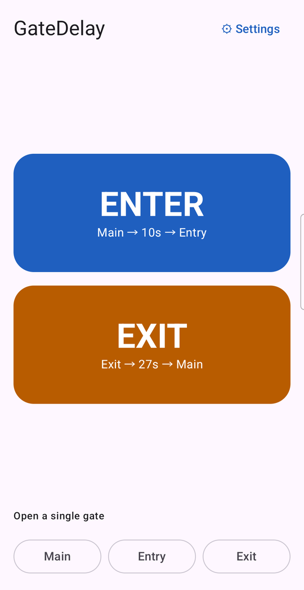
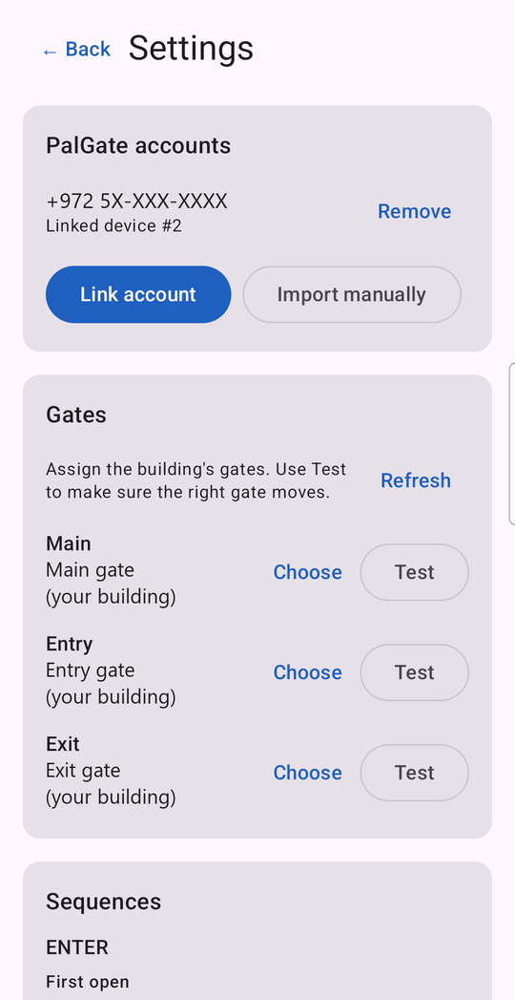
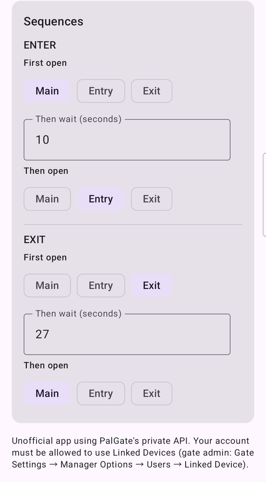
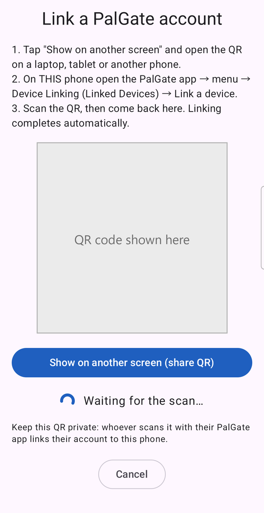

# GateDelay

**One-tap timed gate sequences for PalGate.**

In buildings with a double gate (a main gate, then a separate entry gate and exit gate), you usually have to open one gate in the PalGate app, wait, and then open the next. GateDelay does the whole sequence with one tap:

| Button | What happens |
|---|---|
| **ENTER** | open **Main** gate → wait **10 s** → open **Entry** gate |
| **EXIT** | open **Exit** gate → wait **27 s** → open **Main** gate |

The gates, their order and the waiting times are all configurable.

<p align="center">
  
  &nbsp;
  
  &nbsp;
  
</p>
<p align="center">
  <br>
  <em>Home-screen widgets: one tap runs the whole sequence</em>
</p>

> **⚠️ Unofficial.** GateDelay isn't made by or affiliated with PAL Electronics Systems. It uses the same private PalGate API as the [ha-palgate](https://github.com/doron1/ha-palgate) Home Assistant integration. PalGate may change that API at any time. Use at your own risk.

---

## Contents

- [Features](#features)
- [Requirements](#requirements)
- [Installing the app](#installing-the-app)
- [First-time setup](#first-time-setup)
- [Daily use](#daily-use)
- [Several users / several accounts](#several-users--several-accounts)
- [Troubleshooting](#troubleshooting)
- [Privacy & security](#privacy--security)
- [How it works](#how-it-works)
- [Development](#development)
- [Roadmap](#roadmap)
- [Credits & license](#credits--license)

---

## Features

- **ENTER / EXIT buttons.** Big, one-tap timed sequences with a live countdown. **Open now** skips the wait and **Cancel** stops the sequence.
- **Single-gate buttons.** Small **Main / Entry / Exit** buttons for when you just need one gate.
- **Home-screen widgets.** A blue **ENTER** widget and an orange **EXIT** widget. Tapping one runs the sequence without opening the app.
- **App shortcuts.** Long-press the app icon for ENTER / EXIT / Open Main gate.
- **Runs in the background.** The sequence finishes even if you lock the screen or switch apps. A notification shows progress and has a **Cancel** button.
- **Survives bad reception.** If the phone has no connection, for example while it reconnects to cellular between gates, each gate is retried every 2 s for up to 60 s.
- **Safe by default.** If the first gate fails to open, the second gate is **not** opened.
- **Several PalGate accounts.** Each gate remembers which account it opens through.
- **No server.** The app talks to PalGate directly. Your token is stored encrypted on the phone (Android Keystore).

## Requirements

- An **Android** phone (Android 8.0 or newer). iOS is planned, see [Roadmap](#roadmap).
- The **PalGate app**, installed and working for your gates.
- Your PalGate user must be allowed to use **Linked Devices** on each gate (see [setup step 0](#0-make-sure-linked-devices-are-allowed)).
- A free **linked-device slot** on your PalGate account. PalGate allows about **2** linked devices per account, and GateDelay uses one.
- A **second screen** for the one-time linking step: a laptop, tablet or another phone (see why in [step 2](#2-link-your-palgate-account)).

## Installing the app

There's no Play Store listing. Download the ready-made APK, or build the app yourself.

### Download the APK (easiest)

1. On your phone, open the **[latest release](https://github.com/Moran296/GateDelay/releases/latest)** and download `GateDelay-X.Y.Z.apk` under *Assets*.
2. Open the downloaded file. Android asks you to allow *Install unknown apps* for your browser or file manager. Allow it, then tap **Install**.
3. Continue with [First-time setup](#first-time-setup).

**Updating:** download the newer APK and install it over the old one. Your accounts and settings are kept. The installed version is shown at the bottom of **Settings**, and [CHANGELOG.md](CHANGELOG.md) lists what changed.

> Releases are signed with the project's release key. A copy you built yourself (Option A/B) is signed with a different key, so Android won't install a release over it, or the other way round. To switch, uninstall first. Uninstalling deletes the stored token, so you'd have to link again: first remove the old GateDelay entry in PalGate → *Device Linking* to free the slot.

### Option A: build with Android Studio

1. Install [Android Studio](https://developer.android.com/studio). It includes the Android SDK and Java.
2. Get the code:
   ```bash
   git clone https://github.com/Moran296/GateDelay.git
   ```
3. In Android Studio: **File → Open** → select the `GateDelay` folder. Wait for *Gradle sync* to finish. The first time it downloads dependencies, which takes a few minutes.
4. On your phone, enable **Developer options → USB debugging**: *Settings → About phone → Software information → tap "Build number" 7 times*, then go to *Developer options*. Connect the phone with USB and accept the prompt on the phone.
5. In Android Studio choose the **composeApp** run configuration, select your phone and press **▶ Run**.

### Option B: command line

```bash
# Windows (PowerShell): point JAVA_HOME at Android Studio's bundled JDK, e.g.
$env:JAVA_HOME = "C:\Program Files\Android\Android Studio\jbr"

./gradlew :composeApp:installDebug     # build + install on the connected phone
./gradlew :composeApp:assembleDebug    # just build: composeApp/build/outputs/apk/debug/composeApp-debug.apk
```

### Sharing the app with neighbours / family

Send them the [latest release](https://github.com/Moran296/GateDelay/releases/latest) link (or the APK file itself). Each person installs it and follows [First-time setup](#first-time-setup) with **their own** PalGate account.

> Alternatively, Google Play Console's **Internal testing** track lets up to 100 testers install it from the Play Store by e-mail invite. This needs a one-time $25 developer account.

---

## First-time setup

### 0. Make sure Linked Devices are allowed

GateDelay connects to PalGate as a **linked device**, the same mechanism PalGate uses for smart-home integrations. The gate **administrator** has to allow this for your user:

> PalGate app → *Gate Settings → Manager Options → Users → (your user) → **Linked Device*** ✔

If this isn't enabled, opening a gate fails with *"Linked devices are not allowed for this user…"*.

### 1. Open Settings

Open GateDelay and tap **⚙ Settings** (top right).

### 2. Link your PalGate account



1. Tap **Link account**. A QR code appears with *"Waiting for the scan…"*.
2. **The PalGate app has to scan this QR, but a phone can't scan its own screen.** So show the QR somewhere else. Tap **Show on another screen (share QR)** and send the image to your laptop or tablet (WhatsApp Web, e-mail, Quick Share, …). Open it there, nice and big. A family member's phone screen works too.
3. On **your** phone, open the **PalGate** app → menu (☰) → **Device Linking** (called *Linked Devices* on some versions) → **Link a device**. The camera opens.
   *Choose "Device Linking", not "Add New Device".*
4. Point the camera at the QR on the other screen. PalGate confirms the link.
5. Switch back to GateDelay. The notification *"Waiting for the PalGate QR scan… tap to return"* takes you there. Within a few seconds it shows **✓ Linked +972…**. Tap **Continue**.

Notes:
- **Already have a linked device in PalGate?** That's fine. GateDelay takes the **second** slot and Settings shows *"Linked device #2"*. Your existing linked device isn't affected.
- The QR stays valid for about 15 minutes, even if GateDelay is closed in the meantime.
- **Keep the QR private.** Whoever scans it with *their* PalGate app links *their* account to your phone.
- If a link attempt failed halfway (PalGate shows a new linked device but GateDelay didn't confirm it), delete **only that newest entry** in PalGate → Device Linking and try again.

<br clear="right">

### 3. Choose your gates

In **Settings → Gates** there are three slots: **Main**, **Entry** and **Exit**.

1. Tap **Choose** next to a slot. A list shows every gate your linked accounts can open, with name, address and which account it goes through. A controller with two outputs (e.g. entry and exit on one device) shows each output separately, marked *"(output 2)"*.
2. Pick the matching gate.
3. Tap **Test**. **The gate really opens.** Check that the right one moves: ✓ means PalGate accepted the command and ✗ means it failed, with the reason shown below it.

Repeat for all three slots. Tap **Refresh** if the list is empty or outdated.

### 4. Check the sequences

In **Settings → Sequences**, each sequence has *First open → Then wait (seconds) → Then open*. The defaults are:

- **ENTER**: Main → 10 s → Entry
- **EXIT**: Exit → 27 s → Main

Change the gates or seconds to match your building. Changes save immediately.

### 5. Add the widgets (optional, recommended)

1. Long-press an empty spot on your home screen → **Widgets** → **GateDelay**.
2. Drag **GateDelay ENTER** (blue) and **GateDelay EXIT** (orange) onto the home screen.
3. Resize them as you like. Each widget is one big button.


You can also long-press the GateDelay app icon for **ENTER / EXIT / Open Main gate** shortcuts, and drag those to the home screen too.

---

## Daily use

- **Tap ENTER or EXIT** in the app or on a widget. The first gate opens right away, a countdown runs, then the second gate opens.
  - **Open now** skips the remaining wait.
  - **Cancel** stops before the second gate. It's also available in the notification.
- **Missed a gate?** Use the small **Main / Entry / Exit** buttons at the bottom of the main screen to open just that one.
- **Status:** the app shows each step (✓ opened, ✗ failed, – skipped). The widget's small status line shows e.g. *"Main in 7s"* and then *"Done ✓"*.
- You can lock the phone or switch apps during the wait. The sequence keeps running.

## Several users / several accounts

- **Every resident uses their own phone and their own PalGate account.** Install GateDelay and do the setup once. Nothing is shared between phones and there's no server.
- **One phone, several accounts:** link each account the same way. Each gate slot remembers which account it opens through, so the Main gate can come from one account and the Entry gate from another.
- To remove an account, tap **Remove** in Settings. This frees nothing in PalGate. To release the linked-device slot, also delete it in PalGate → Device Linking.

---

## Troubleshooting

| Problem / message | What to do |
|---|---|
| *Linked devices are not allowed for this user on this gate* | The gate admin must enable **Linked Device** for your user (see [step 0](#0-make-sure-linked-devices-are-allowed)). |
| *Not authorized – re-link this account* | The link was removed in PalGate. **Remove** the account in GateDelay and link again. |
| PalGate shows the new linked device, but GateDelay never said "Linked" | Delete that newest entry in PalGate → Device Linking (keep your other ones), then link again. Make sure you're on the latest GateDelay version, because older builds lost the reply while in the background. |
| Linking keeps waiting | Did you use **Device Linking → Link a device** (not "Add New Device")? Is there a free slot (max ~2)? Is the QR less than 15 minutes old? |
| *The gate controller is offline ("check device")* | The PalGate controller has no connection right now. Try again later or use the PalGate app. |
| Gate list is empty | Tap **Refresh**. If an account has a problem, its error is shown above the list. |
| Second gate didn't open | This is deliberate if the first gate failed. The status card shows why. |
| Nothing happens when tapping a widget | Open the app once after installing or updating. The widget then says *"Set up in app"* if the gates aren't configured. |
| Opens are flaky | Make sure the phone's time is set automatically. The PalGate auth token is time-based. |
| Sequence stops when the phone sleeps (some Samsung/Xiaomi phones) | *Settings → Apps → GateDelay → Battery → Unrestricted.* |

## Privacy & security

- **No GateDelay server.** The app only talks to PalGate's API (`api1.pal-es.com`).
- Your PalGate **session token** is encrypted with a key held by the **Android Keystore** and never leaves the phone. It's excluded from backups.
- The linking QR contains a random one-time ID created with a cryptographically secure random generator. It's drawn on the phone and never sent to any online QR service.
- Removing an account deletes its token from the phone.

---

## How it works

GateDelay re-implements the small part of the PalGate protocol that [ha-palgate](https://github.com/doron1/ha-palgate) and [pylgate](https://github.com/DonutByte/pylgate) figured out:

1. **Device linking.** The app creates a random ID and shows it as the QR code `{"id": "<uuid>"}`. It then waits on `GET /v1/bt/un/secondary/init/<uuid>`. When the PalGate app scans the QR, that request returns the account's phone number (user ID), a 16-byte session token, and the token type (1st or 2nd linked device).
2. **Authentication.** Every request carries an `x-bt-token` header. This is a short-lived token derived from the session token, the phone number and the current time with a custom AES-128 routine, so it's valid for only a few seconds. The app corrects for phone clock drift using the server's `Date` header.
3. **Gates.** `GET /v1/bt/devices` lists the account's gate controllers. `GET /v1/bt/device/<id>/open-gate?openBy=100&outputNum=<n>` opens one output.
4. **Sequences.** A small state machine opens gate A, counts down, then opens gate B. Network errors are retried once. API errors stop the sequence. On Android this runs in a short foreground service, so it survives a locked screen and works from widgets.

## Development

```
shared/                 Kotlin Multiplatform library, no UI (Android + JVM now, iOS later)
  palgate/              PalgateAes, TokenGenerator (port of pylgate), PalgateApi (Ktor)
  data/                 GateRepository (config, accounts, gates), DeviceLinker (QR linking)
  sequence/             SequenceRunner: ENTER/EXIT state machine, single-gate opens
  storage/              KeyValueStore / SecretStore interfaces
  commonTest/           token test vectors from pylgate, sequence tests (mock HTTP + virtual time)
composeApp/
  commonMain/ui/        Compose Multiplatform screens: Home, Settings, Link
  androidMain/          MainActivity, SequenceService, LinkService, Glance widgets,
                        shortcuts, Keystore secret store, QR rendering (ZXing)
tools/link_probe.py     Python helper: test PalGate linking / get credentials for "Import manually"
PLAN.md                 Design notes, decisions and roadmap
```

**Build & test**

```bash
./gradlew :shared:jvmTest              # protocol + sequence unit tests (fast, any OS)
./gradlew :composeApp:assembleDebug    # Android debug APK
./gradlew :composeApp:lintDebug        # Android lint
```

**Versioning & releases.** The version is set in one place, `gradle.properties` (`gatedelay.versionName`, [semver](https://semver.org), plus `gatedelay.versionCode`, which must go up by 1 every release). Each release is a git tag `vX.Y.Z` with a signed APK attached on GitHub Releases. To publish one:

1. Bump both values in `gradle.properties` and add a `## X.Y.Z` section to `CHANGELOG.md`. Commit and push.
2. Run `bash tools/release.sh`. It runs the tests, builds and signs the APK, tags, pushes, and creates the GitHub release with the changelog section as notes.

Signing uses `keystore.properties` in the project root, which git ignores:
```properties
storeFile=C:/path/to/gatedelay-release.jks
storePassword=...
keyAlias=gatedelay
keyPassword=...
```
**Back up the keystore and its passwords.** If they are lost, users can't update. They'd have to uninstall and link again. Without `keystore.properties`, `assembleRelease` builds an unsigned APK.

**Tech:** Kotlin 2.2, Compose Multiplatform 1.9, Ktor 3, kotlinx.serialization/coroutines, Jetpack Glance (widgets), ZXing (QR). Gradle 8.13, AGP 8.12, JDK 17+.

**Token test vectors:** `TokenGeneratorTest` compares the Kotlin port with output from pylgate. To add vectors:
```bash
pip install git+https://github.com/DonutByte/pylgate.git
python -c "from pylgate.token_generator import generate_token; print(generate_token(bytes.fromhex('00112233445566778899aabbccddeeff'), 972501234567, 1, timestamp_ms=1700000000))"
```

**`tools/link_probe.py`** (`pip install requests qrcode pillow`):
- `python tools/link_probe.py link` links an account by showing the QR on the PC and prints phone/token/type for **Settings → Import manually**.
- `timeout` / `resume` modes measure how the linking endpoint behaves. Each successful scan uses a linked-device slot.

## Roadmap

- **iOS** (needs a Mac). The logic in `shared/` and the UI in `composeApp/commonMain` are already multiplatform. What's left: iOS targets, an Xcode host app, a Keychain secret store, and a share sheet for the QR.
- **iOS widgets / Siri / Shortcuts** through WidgetKit and App Intents. The widget will launch the app to run the sequence, because iOS doesn't allow a 27 s background wait from a widget.
- Ideas: Android Quick Settings tile, Android Auto / CarPlay buttons, sequences with more than two gates.

See [PLAN.md](PLAN.md) for details.

## Credits & license

- [doron1/ha-palgate](https://github.com/doron1/ha-palgate) (Apache-2.0): PalGate API, device-linking flow.
- [DonutByte/pylgate](https://github.com/DonutByte/pylgate) (GPL-3.0): PalGate token generation. GateDelay's `PalgateAes.kt` / `TokenGenerator.kt` are a Kotlin port of it.

GateDelay is licensed under the **GNU General Public License v3.0**. See [LICENSE](LICENSE).

*PalGate is a trademark of PAL Electronics Systems Ltd. This project isn't affiliated with or endorsed by them.*
